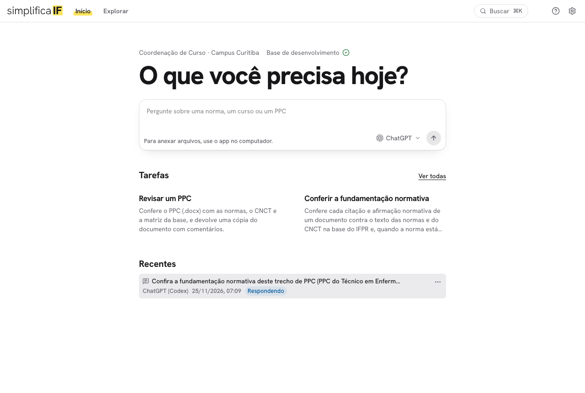
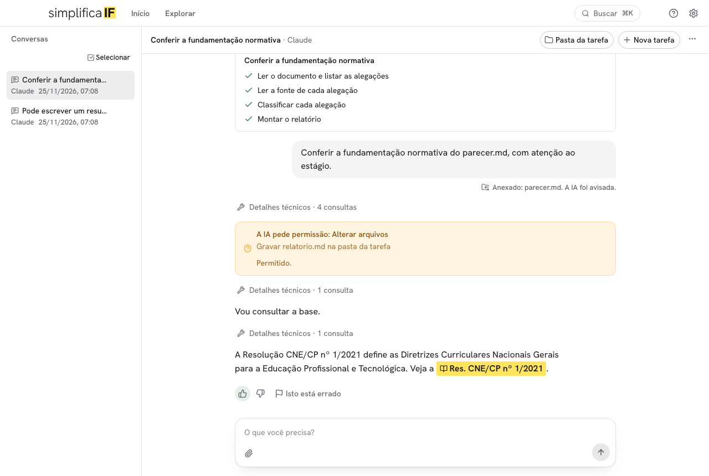

<h1>
  <picture>
    <source media="(prefers-color-scheme: dark)" srcset="docs/marca/logo-escuro.svg">
    
  </picture>
</h1>

**As normas, os cursos e os PPCs do IFPR, prontos para a IA que você já usa.**

O Simplifica IF é um app Desktop para quem trabalha no IFPR. Você pergunta e a IA da sua conta pessoal (Claude, ChatGPT ou Gemini) responde consultando uma base com a legislação, os regulamentos e os documentos do Instituto. Toda resposta diz de onde saiu: um clique na citação abre a norma no trecho citado.

## O que dá para fazer

- **Perguntar.** "Qual é a carga horária mínima de estágio num curso técnico?" A IA procura na base, responde e cita o artigo.
- **Revisar um PPC.** Você entrega o `.docx`, e o app confere o documento com as normas, o Catálogo Nacional de Cursos Técnicos e os dados do curso. A resposta é uma lista do que corrigir e do que conferir, e uma cópia do documento com comentários no Word.
- **Conferir a fundamentação de um documento.** Parecer, minuta ou relatório: o app verifica se cada norma citada existe, está em vigor e diz o que o texto afirma.
- **Explorar a base, sem IA.** Normas, cursos, campi, PPCs, o CNCT e as reuniões do Consepe, com busca e com a situação de vigência de cada norma.

## Como funciona

- **Você usa a sua conta de IA.** O app não tem IA própria nem cobra nada: ele entrega a base e as tarefas à assinatura que você já tem.
- **A base fica no seu computador**, e as versões novas chegam pelo próprio app. Suas conversas e seus arquivos também ficam só nele; para a empresa da IA vai o que você escreve e anexa.
- **A fonte vem junto.** O que está grifado em amarelo aponta para um documento da base. Norma revogada não some: o app mostra o que a substituiu e as regras de transição.
- **Nada se perde.** Cada tarefa tem uma pasta em `Documentos/Simplifica IF`, e o que a IA altera nos arquivos pode ser desfeito.

O app trabalha com dado público. Não anexe dados pessoais nem documentos de acesso restrito, e confira a fonte antes de usar uma resposta em documento oficial: a IA pode errar, e o app não substitui parecer jurídico nem a publicação oficial das normas.

## Em que pé está

O Simplifica IF está em desenvolvimento, a caminho de um piloto com um grupo pequeno de servidores. Ainda não há instalador público; por enquanto, quem quer experimentar roda o app a partir do código ([`CONTRIBUTING.md`](CONTRIBUTING.md#ambiente)). O que já está pronto e o que falta estão em [`docs/plans/`](docs/plans/README.md).

## Projeto independente

O Simplifica IF é mantido por servidores e colaboradores do IFPR na organização Comunidade IFPR. Não representa o IFPR nem é mantido oficialmente por ele.

## Como ajudar

Achou uma norma faltando, um dado errado ou uma resposta ruim? [Abra uma issue](https://github.com/comunidade-ifpr/simplifica-if/issues). Correções da base, normas novas e código entram por pull request: o [`CONTRIBUTING.md`](CONTRIBUTING.md) diz como montar o ambiente, onde fica cada parte e o que rodar antes de enviar. Para avisar uma falha de segurança ou um dado pessoal publicado, siga o [`SECURITY.md`](SECURITY.md).

## Licença

- **Código** (aplicativo, pacotes, scripts e skills): licença MIT, em [`LICENSE`](LICENSE). Partes copiadas do T3 Code mantêm o aviso MIT de origem ([`docs/upstream-t3.md`](docs/upstream-t3.md)), e o instalador leva o `LICENCAS.md`, com a licença de cada pacote de terceiros.
- **Conteúdo curatorial** (`base-conhecimento/`): CC BY 4.0, em [`LICENSE-DADOS`](LICENSE-DADOS). Ela não cobre os atos oficiais (livres, pela Lei nº 9.610/1998, art. 8º, IV) nem os PPCs e documentos institucionais reproduzidos, que mantêm o regime de origem.
